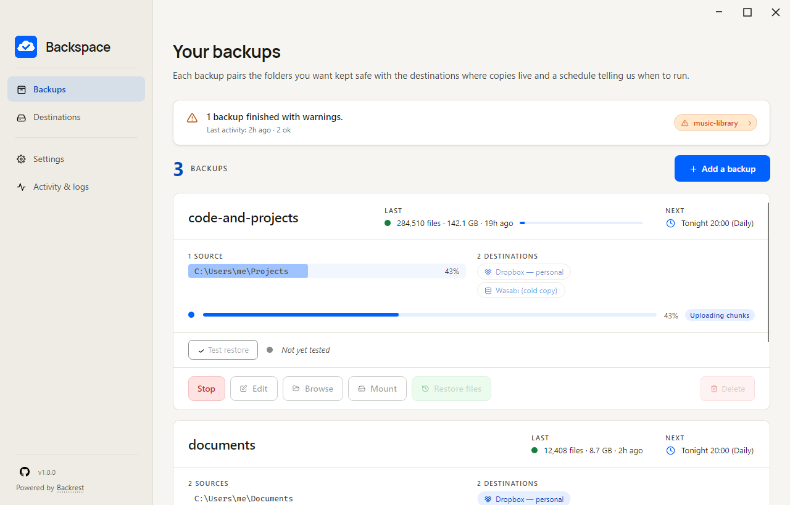
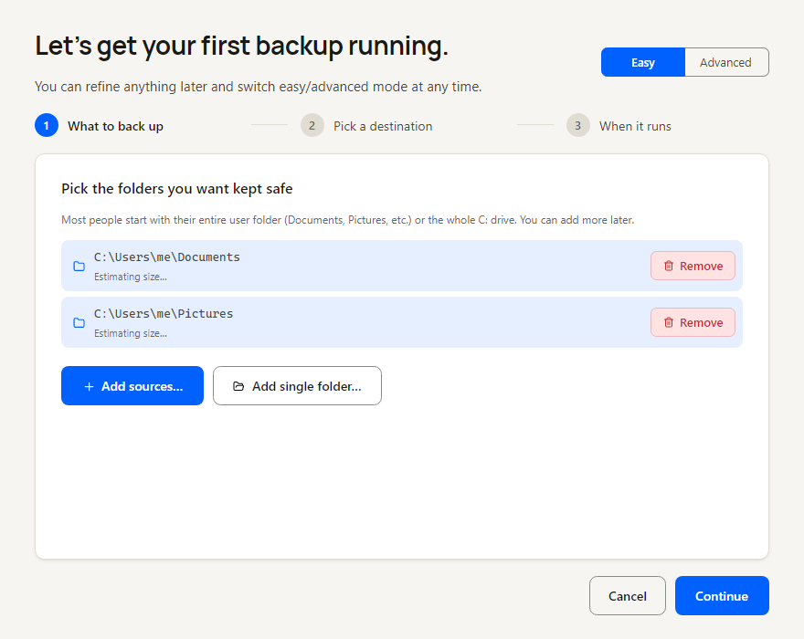
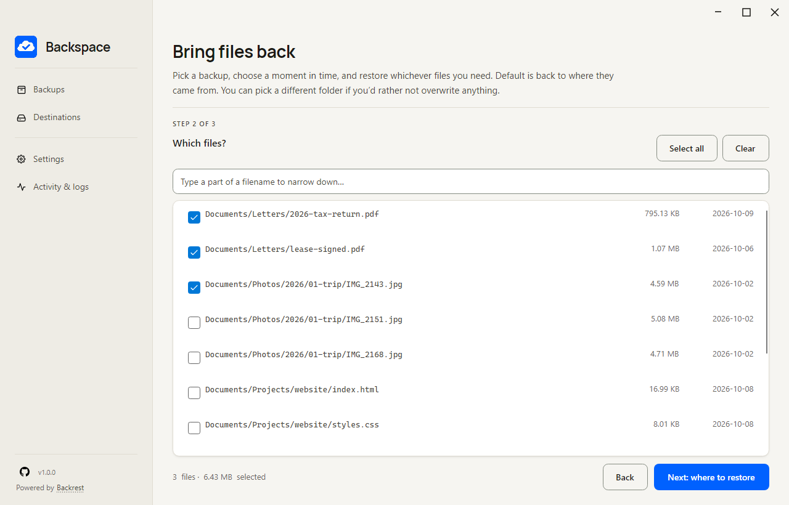

# Backspace — Restic Backups Made Easy

A friendly desktop GUI for [restic](https://restic.net), driven by a
bundled [Backrest](https://github.com/garethgeorge/backrest) daemon. The
whole philosophy: **setting up a backup is three steps, restoring a file
is three steps.** If you can count to three, you can use Backspace.

Pick the folders you care about, pick where the backups should live
(local folder, external drive, SMB share, Dropbox, OneDrive, Google
Drive, or any S3-compatible storage), set a schedule, and forget about
it. One `.exe`, one config folder, zero shell scripting.

Encrypted, deduplicated, fully under your control. Powered by the
proven restic engine and bundled rclone for cloud destinations.

> ⚠️ **No warranty. Backup software is "AS IS".** Backspace may fail to
> run, miss schedules, or fail to restore. The authors are not liable for any
> data loss, business interruption, or other damage. **You are responsible
> for verifying your backups, periodically testing restores, and keeping
> redundant copies of important data** (the 3-2-1 rule: three copies, two
> media, one offsite). See [LICENSE](LICENSE) for the full terms — by using
> the software you accept them.

## Status

Backspace is functional and covers the everyday backup loop end-to-end —
configure, schedule, monitor, restore. It hasn't accumulated enough real-world
mileage to call itself stable yet; broader use will surface the rough edges
that one developer's machine never hits. Help us shake those out by trying it
and reporting anything that surprises you.

- **Tested on Windows 11.** Automated checks cover the interface and real local backup/restore operations. Current live-cloud, reboot and native updater acceptance checks are still pending; see the active roadmap. Windows 10 has not been exercised.
- **No testing on macOS or Linux yet.** The code targets both via Avalonia
  and there's no architectural reason it shouldn't run — but no one has
  actually launched it there. If you do, please file an issue with what
  you saw.
- Issues, PRs, and field reports are very welcome.

## Screenshots

See the [project website](https://backspace-backup.github.io/) for the
full visual tour. A few highlights:

### Watch a backup run



Every backup at a glance. Status, last run, next run, source, destination —
and a live progress bar while one is running.

### Set up your first backup in three steps



Pick a folder, pick a destination, pick a schedule. The wizard walks
first-time users from cold install to first backup in under a minute.

### Restore exactly what you need



Browse a snapshot, tick the files you want back, choose where they go.
Watch progress as the engine restores your selection. You can leave the wizard,
return through Restores, or cancel safely while other work continues.

### Browse and mount snapshots in place

Every snapshot is browsable straight from the backup card — no need to
launch a full restore wizard just to peek at "what was in last Tuesday's
backup". Tap **Browse snapshot** to walk the tree inline.

For deeper inspection, the **Mount** button exposes the snapshot as a
read-only volume in Windows Explorer through Backspace's WinFSP filesystem.
Windows mounting requires the WinFSP runtime; the app checks for it before mounting.
Open files with your usual apps, diff against your current working
copy, copy out individual files by drag-and-drop — Explorer treats the
snapshot like any other folder. Backspace cleans up the mount when you
unmount or close the app.

## What it does

- **Windows updates**: Settings → App updates checks GitHub for stable releases. Checks are monthly by default; choose daily, weekly, or never, or check manually. Read the release notes, skip a version, or download and restart when ready. Installation waits for active work, verifies the complete Windows bundle, and preserves the portable configuration folder. A recovery launcher and the previous application files remain available if the new version will not start. Development builds and folders without write access offer a manual download instead. The packaged update/restart flow still needs native Windows acceptance testing; see the active roadmap.

- **Destinations**: local folder, external drive (with volume-name matching —
  backups skip gracefully when the drive isn't plugged in, not fail), SMB /
  network share, Dropbox (app-scoped), OneDrive (personal + Business),
  Google Drive, S3-compatible (Wasabi, Cloudflare R2, MinIO, Backblaze-B2-via-S3).
- **VSS shadow copies on Windows**: locked / in-use files (Outlook, SQL
  Server data files, browser profiles) get backed up cleanly via a brief
  elevated helper that takes a Volume Shadow Copy. Toggleable per backup.
- **Filters**: edit restic's filter syntax with a live simulation pane that
  shows exactly which files would be included or excluded before you run.
- **Scheduling**: per-platform native scheduler integration — Windows Task
  Scheduler on Windows, launchd user agents on macOS, systemd user timers on
  Linux. No always-on process; the app only runs when you open it or a
  scheduled job kicks in.
- **Metered-network guard**: folded in-process on Windows (the only OS that
  exposes a first-class metered-network signal). If your laptop switches to a
  metered connection mid-backup, the run aborts cleanly instead of eating
  your data plan. The toggle is hidden on macOS / Linux. The same guard wraps
  standalone prune and check runs — a tethered phone connection mid-prune
  cancels the prune cleanly, surfaced as Skipped with the metered reason in
  Activity & logs.
- **Schedule preconditions inherit to maintenance**: prune and check schedules
  inherit the main backup's "skip on battery", "stop on battery",
  "require network", and "catch up missed runs" settings — so a laptop
  closed lid past the prune window resumes when it wakes (StartWhenAvailable)
  and never starts on battery (DisallowStartIfOnBatteries). One set of
  preconditions across backup + prune + check, configured once on the
  Backup's schedule.
- **Monitoring**: Healthchecks.io auto-setup (paste your API key, we create
  and name the checks for you). Local early-warning via stdout parsing for
  `ERROR` / `Failed to` / `access denied`. Toast + topmost alert with sound
  (bypasses Focus Assist for failures by default).
- **Email**: optional, via [Resend](https://resend.com) (free for 3000 emails/month,
  API-key only) or Mailgun SMTP.
- **Restore**: a step-by-step wizard — pick the backup, choose a moment in
  time, tick the files you want, pick where they land, go. Parallel restore
  with per-file retry cascade.
- **Test-restore drill**: one-click "is this backup actually restorable?"
  — picks ten random files from the latest snapshot, restores them to a
  temp dir, and byte-compares against the live source. Complements (not
  replaces) restic's built-in `check` — that one verifies the repository's
  internal integrity, this one verifies the round-trip: *what we backed
  up is what's actually on disk right now*. See
  [the test-restore drill section](#the-test-restore-drill) below for the
  freshness logic + mid-flight edit handling. Surfaced on the Dashboard so
  stale verifies (older than 30 days) get flagged before you need them.
- **Destructive actions**: "erase destination" and "prune to latest revision"
  live behind a type-to-confirm dialog.

## Quick start

### Download

Grab the latest release zip from
[Releases](https://github.com/backspace-backup/backspace/releases/latest).
Unzip somewhere, double-click `Backspace.exe`. The executable is
portable — no installer required.

### First-run

The first time you launch, Backspace walks you through the onboarding
wizard: pick a source folder, pick a destination, set a schedule. Three
clicks to your first backup. Default schedule is daily at 8 PM with retention
"keep daily snapshots for 7 days, weekly for 30, monthly for 90, yearly for
365" — which the wizard lets you customize.

### Import from existing Duplicacy

Coming from Duplicacy? **Settings → Import from existing Duplicacy** can
read either layout:

- The folder containing your `.duplicacy/` directory (plain Duplicacy users)
- A parent folder containing several such repos (the duplicacy-util convention)

We import storage URLs, repository paths, filters, and per-storage
threads / keep / prune / check settings into Backspace's restic-shaped
config. Your existing Duplicacy storage is **left untouched** — Backspace
starts a fresh restic chain at your chosen destination; your cloud tokens
are NOT imported either, so Backspace will prompt you to re-authenticate
the first time it talks to each destination.

## The test-restore drill

A successful backup run on its own is a *claim* — bytes were uploaded,
the engine reported success, the log looks healthy. None of that
actually proves the bytes you uploaded match what's on your disk and
that you can pull them back unchanged. The test-restore drill exists
to convert that claim into a check.

What it does, end-to-end:

1. Lists every file in the latest snapshot of **each source at each destination**, including empty files. It also checks whether an unchanged, included local file is missing from the snapshot.
2. Restores files in batches of 128 to a private temporary directory. This limits temporary disk usage, although a single large file still needs enough free space for its full size. Testing a cloud destination downloads the restored data and uses the destination's bandwidth limits.
3. Checks each restored file's size against the snapshot and compares its bytes with the local original when that original is still unchanged. Files edited or removed since the backup are reported as restored but not byte-compared, rather than counted as verified matches.
4. Shows per-source and per-destination results and records each file's result in Activity & logs. Missing files, mismatches and restore failures remain visible. Cancel stops the engine operation before its temporary files are cleaned up.

The drill is a full recovery check, so large backups can take time. It is started on demand from **Test restore**; it does not silently download your cloud backups on a schedule.

This is **not** restic's `check` — that one verifies the repository's
internal Merkle structure (blobs, packs, indexes) and is what catches
on-storage bit rot or torn writes. The test-restore drill verifies the
*round-trip*: that what restic claims to have stored, restored back to
a fresh filesystem, matches the bytes you'd want to recover. Both are
useful; they answer different questions.

Run it from the Dashboard tile's "Test restore" button. The drill
honours your destination's bandwidth limits and is cancellable
mid-flight. Auto-triggering would silently consume cloud bandwidth on
schedule — that's left as a user choice for now.

## Portability

Everything Backspace creates on disk lives in **one folder** next to the
executable: `Backspace.config/`. That folder holds `config.json`, Backrest's
state directory, run logs, per-backup snapshot ids, and an encrypted
`secrets.bin`. The bundled engine binaries (restic / Backrest / rclone)
sit beside the application executable.

**Backing up that folder = backing up your whole setup.** Drop the binary
and the `Backspace.config/` folder on a new machine, re-enter your
storage passwords and API keys (the secrets vault is bound to the local
machine — DPAPI on Windows, an AES-GCM keyfile on macOS / Linux — so it
doesn't travel), and you're back in business. Your backup definitions —
names, sources, destinations, filters, schedules — travel losslessly.

## Building from source

Before publishing a release, follow [the release checklist](docs/RELEASING.md).
It covers the large real-engine test and human review of current documentation
and screenshots. The prepared checking workflow does not yet enforce publishing approval.

Requires .NET 10 SDK. The project multi-targets `net10.0-windows10.0.19041.0`
(full Win32 stack) and `net10.0` (cross-platform fallback used on macOS / Linux).

```bash
# Windows — full feature set
dotnet publish src/Backspace -c Release -r win-x64 --self-contained \
  -f net10.0-windows10.0.19041.0
# → bin/Release/net10.0-windows10.0.19041.0/win-x64/publish/Backspace.exe

# macOS — native ARM build (use osx-x64 for Intel)
dotnet publish src/Backspace -c Release -r osx-arm64 --self-contained \
  -f net10.0 -p:PublishSingleFile=true
# → bin/Release/net10.0/osx-arm64/publish/Backspace

# Linux x64
dotnet publish src/Backspace -c Release -r linux-x64 --self-contained \
  -f net10.0 -p:PublishSingleFile=true
# → bin/Release/net10.0/linux-x64/publish/Backspace
```

Convenience scripts: `launch-debug.bat` / `launch-release.bat` on Windows;
`launch-debug.sh` / `launch-release.sh` on macOS / Linux.
Add `--build-only` to build or publish without opening the app. The release
script publishes into `dist` while preserving its existing portable
configuration and other files. These scripts do not stop running apps or
seed test configuration. If a build reports files in use, choose **Quit**
in the app using that output, let its operations finish, and retry.
The debug launcher enables verbose logs under its `Backspace.config/logs/app`
folder. The shell release script also accepts an explicit runtime such as
`./launch-release.sh --build-only linux-x64` for cross-publishing.

The build **auto-downloads** the host-platform restic, Backrest, and
rclone binaries from their official GitHub releases the first time it
can't find them under `src/Backspace/Assets/`, and bundles them into
the published output. To build offline, either drop the binaries in
manually or pass `-p:SkipBackrestDownload=true`.

## Running from the command line

```
Backspace                          # launch GUI
Backspace --run <backup-name>      # unattended single-backup run (scheduler entry point)
Backspace --run-all                # unattended, all enabled backups
Backspace --migrate <path>         # one-off import from an existing Duplicacy setup
Backspace --version
```

## License

Backspace is open-source software released under the **BSD 2-Clause
License** — see [LICENSE](LICENSE) for the legal text. Chosen to match
the upstream restic license, since this app is fundamentally a UI on
top of restic + Backrest + rclone.

The license covers the Backspace source code only. The bundled restic /
Backrest / rclone binaries are distributed by their respective upstream
projects under their own license terms — refer to each project for the
specifics if you intend to redistribute a Backspace build.

## Acknowledgments

- [restic](https://restic.net) by Alexander Neumann — the proven, BSD-2
  backup engine that does the hard part.
- [Backrest](https://github.com/garethgeorge/backrest) by Gareth George —
  the Go daemon that wraps restic with a clean RPC API; Backspace runs
  it as a sidecar.
- [rclone](https://rclone.org) by Nick Craig-Wood — the universal
  cloud-storage adapter that makes Dropbox / OneDrive / Google Drive /
  S3 / WebDAV all look the same to restic.
- [Avalonia](https://avaloniaui.net/) — the cross-platform UI framework.
