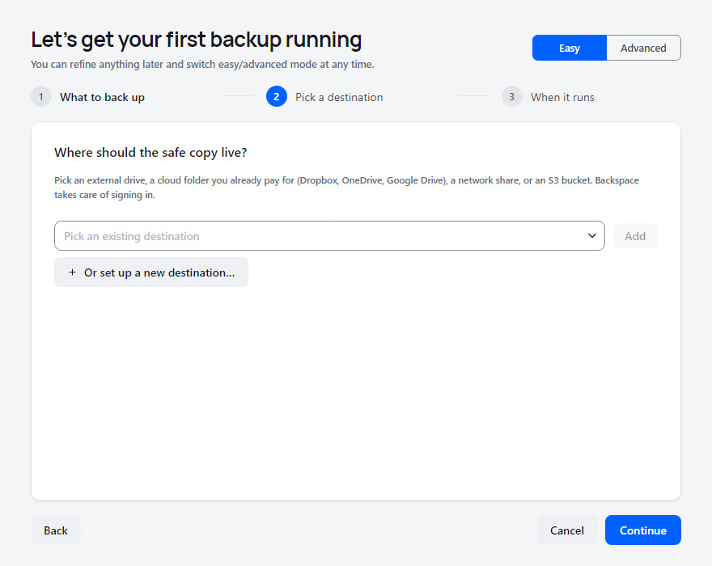
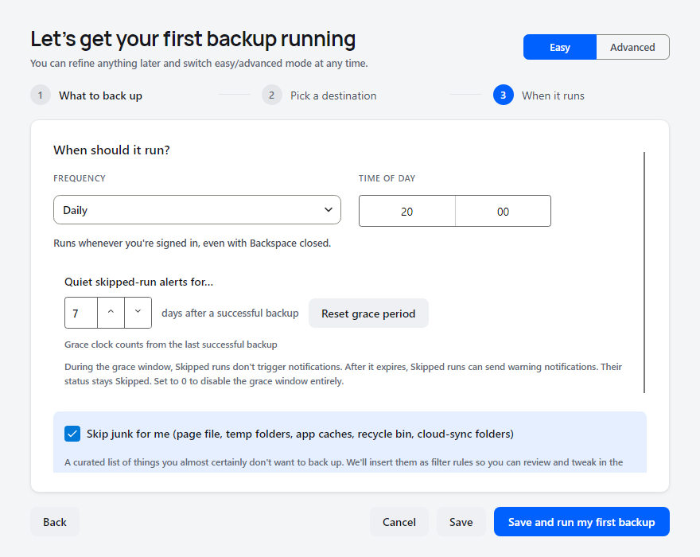
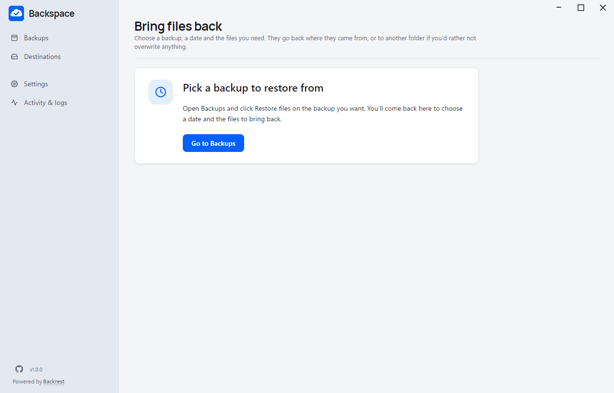

<p align="center">
  
</p>

<h1 align="center">Backspace</h1>

<p align="center">
  <strong>Set-and-forget encrypted backups for Windows.</strong><br>
  Back up in three steps. Restore any file from any day. Know that your backups actually work.
</p>

<p align="center">
  <a href="https://github.com/backspace-backup/backspace/releases/latest"></a>
  <a href="LICENSE"></a>
  
  
  <a href="https://restic.net"></a>
</p>

<p align="center">
  <a href="https://github.com/backspace-backup/backspace/releases/latest"><strong>Download for Windows</strong></a>
  &nbsp;·&nbsp;
  <a href="https://backspace-backup.github.io">Website</a>
  &nbsp;·&nbsp;
  <a href="docs/USER-GUIDE.md">User guide</a>
</p>

<p align="center">
  
</p>

Backspace is a friendly desktop app for [restic](https://restic.net), the
proven open-source backup engine. Pick your folders, pick where the backups
go, pick a schedule, and forget about it. Your files are encrypted on your
computer before they leave it, and only what changed is uploaded.

It's one portable `Backspace.exe` with its settings in a folder beside it: no
installer, no account, no subscription.

## Why Backspace

<table>
  <tr>
    <td width="33%" valign="top">
      <h3>🔒 Encrypted and private</h3>
      Everything is encrypted with your password before it leaves your computer.
      Your cloud provider stores data it can't read.
    </td>
    <td width="33%" valign="top">
      <h3>☁️ Your storage, your choice</h3>
      Dropbox, OneDrive, Google Drive, S3-compatible storage, a network share,
      an external drive or a local folder. Sign in to cloud accounts with one click.
    </td>
    <td width="33%" valign="top">
      <h3>⚡ Small and fast</h3>
      Deduplication stores each piece of data once, across every version, so
      each new backup only uploads what changed.
    </td>
  </tr>
  <tr>
    <td valign="top">
      <h3>🕰️ Every file, every day</h3>
      Restore one file or a whole folder from any snapshot, or open a snapshot
      as a read-only drive in File Explorer.
    </td>
    <td valign="top">
      <h3>✅ Backups you can trust</h3>
      Test restores recover your files for real, on demand or on a schedule,
      so a broken backup doesn't wait for the day you need it.
    </td>
    <td valign="top">
      <h3>🪶 Quiet in the background</h3>
      Lives in the tray like Dropbox and uses no CPU between backups. With
      administrator access it includes open files and runs before you sign in.
    </td>
  </tr>
</table>

## Set up a backup in three steps

<table>
  <tr>
    <td width="33%"></td>
    <td width="33%"></td>
    <td width="33%"></td>
  </tr>
  <tr>
    <td align="center"><strong>1.</strong> Choose what to protect</td>
    <td align="center"><strong>2.</strong> Choose where it goes</td>
    <td align="center"><strong>3.</strong> Choose when it runs</td>
  </tr>
</table>

The default schedule runs daily at 8 PM and keeps daily versions for a week,
weekly for a month, monthly for three months and yearly for a year. Change any
of it in the wizard or later.

## Restore exactly what you need

<table>
  <tr>
    <td width="50%"></td>
    <td width="50%"></td>
  </tr>
  <tr>
    <td align="center">Choose a moment in time</td>
    <td align="center">Tick the files you want back</td>
  </tr>
</table>

Choose where the files land, whether to replace what's there and whether to
keep the original folders. Pause, resume or cancel at any time: cancelling
puts your original files back.

## Get started

1. Download `Backspace-windows-x64.zip` from the
   [latest release](https://github.com/backspace-backup/backspace/releases/latest)
   and check it against `SHA256.txt`.
2. Unzip it anywhere you like, such as your Documents folder or a USB drive.
3. Open `Backspace.exe`. The wizard sets up your first backup.

Backspace needs Microsoft .NET 10. If it's missing, Backspace offers to
install it on first launch.

Windows shows "Unknown publisher" when Backspace asks for administrator access,
because `Backspace.exe` isn't code-signed yet.

## How it runs

- **Starts with Windows** and waits in the tray. Close the window and backups
  keep running on schedule.
- **Quit** from the tray stops automatic backups until you open Backspace
  again, sign out or restart. Nothing runs behind your back.
- **Administrator access** (optional, approved when you turn it on) installs a small background
  service. Backups then include files that other programs have open (Windows
  snapshots, VSS) and run even before you sign in. Later changes to your
  backups never ask again.
- **Portable**: your settings, history and encrypted credentials live in
  `Backspace.config` next to the app. Copy both to move to a new computer.

Read the [user guide](docs/USER-GUIDE.md) for schedules and their conditions,
test restores, checks, alerts and every other detail.

## Status

Version 1.0 is the first stable release. Before each release, the exact build
passes the full test suite, a real 20,000-file backup and restore with every
file compared, live backups and restores on Dropbox, OneDrive and Google Drive,
and scheduled backups before sign-in in an isolated Windows 11 virtual machine.

| | |
|---|---|
| **Windows 11** | Supported and tested |
| **Windows 10** | Not tested yet |
| **macOS, Linux** | Builds, never launched yet. Field reports welcome |
| **OneDrive for Business** | Not supported yet |
| **Network shares** | Backed up while you are signed in, without Windows snapshots, even with administrator access |

> [!WARNING]
> **No warranty.** Backup software is provided "as is" and may fail to run,
> miss schedules or fail to restore. The authors are not liable for data loss or
> other damage. You are responsible for verifying your backups, testing restores
> and keeping redundant copies of important data (the 3-2-1 rule: three copies,
> two media, one off-site). See [LICENSE](LICENSE).

## Coming from Duplicacy?

**Settings → Import existing backups** imports your Duplicacy backups' folders,
destinations, filters and retention settings. Filter rules keep their meaning,
including include rules. Your existing Duplicacy storage and its history are
left untouched; Backspace starts a fresh restic repository beside it.
[Details](docs/USER-GUIDE.md#importing-from-duplicacy).

## Building from source

You need the .NET 10 SDK. The build downloads the restic, Backrest and rclone
binaries it bundles from their official GitHub releases (pass
`-p:SkipBackrestDownload=true` to build offline with binaries you place under
`src/Backspace/Assets/`).

```bash
# Windows, full feature set
dotnet publish src/Backspace -c Release -r win-x64 --self-contained false -f net10.0-windows
# → bin/Release/net10.0-windows/win-x64/publish/Backspace.exe

# macOS (osx-arm64 or osx-x64) and Linux (linux-x64), untested
dotnet publish src/Backspace -c Release -r linux-x64 --self-contained -f net10.0 -p:PublishSingleFile=true
```

`launch-debug.bat` and `launch-release.bat` (or the `.sh` versions) build and
open the app; add `--build-only` to only build. The release script publishes
into `dist` and keeps its portable configuration. The debug launcher turns on
verbose logs under `Backspace.config/logs/app`. If a build reports files in
use, choose **Quit** in the app using that output and retry.

Releases follow [the release checklist](docs/RELEASING.md) for the exact
commit. [Contributing](CONTRIBUTING.md), [architecture](docs/ARCHITECTURE.md)
and [testing](docs/TESTING.md) cover the rest.

## License

Backspace is open source under the [BSD 2-Clause License](LICENSE), the same
license as restic. It covers Backspace's own source code; the bundled restic,
Backrest and rclone binaries are distributed under their own projects' terms.

## Acknowledgments

Backspace stands on excellent open-source work:

- [restic](https://restic.net) by Alexander Neumann, the backup engine that
  does the hard part.
- [Backrest](https://github.com/garethgeorge/backrest) by Gareth George, which
  wraps restic in a clean API; Backspace runs it in the background.
- [rclone](https://rclone.org) by Nick Craig-Wood, which connects restic to
  Dropbox, OneDrive and Google Drive.
- [Avalonia](https://avaloniaui.net/), the cross-platform UI framework.
